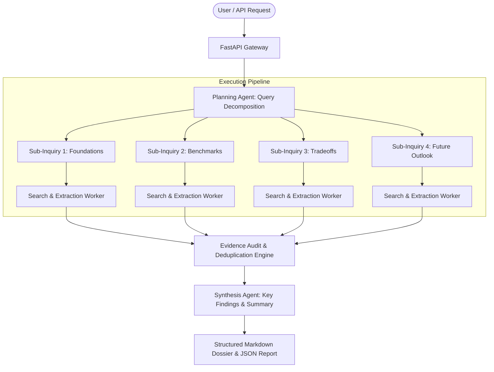

# Autonomous Multi-Agent Research & Synthesis Engine

[](LICENSE)
[](https://python.org)
[](https://fastapi.tiangolo.com)
[](Dockerfile)
[](https://github.com/samaysawal24)

An autonomous multi-agent deep research system that breaks down complex user inquiries into atomic sub-questions, executes concurrent asynchronous web scraping, deduplicates and ranks evidence, and synthesizes comprehensive research dossiers with full citations.

---

## 🏛️ System Architecture



---

## 🚀 Key Features

- **Autonomous Query Decomposition:** Transforms high-level ambiguous queries into distinct, targeted sub-queries.
- **Concurrent Asynchronous Retrieval:** Dispatches parallel non-blocking workers using `httpx` and `asyncio`.
- **Intelligent Evidence Deduplication:** Cleans URLs, ranks relevance scores, and discards redundant snippets.
- **Auditable Citations:** Links each key finding to verifiable source URLs.
- **Production REST API:** Built with FastAPI, background tasks, and real-time job status polling.
- **Zero-Dep Lock-in:** Designed cleanly with zero proprietary vendor lock-in.

---

## 📦 Project Structure

```
autonomous-research-agent/
├── agent/
│   ├── __init__.py           # Package exports
│   ├── core.py               # ResearchAgentEngine orchestrator
│   ├── models.py             # Pydantic v2 schemas
│   ├── search.py             # Async search provider & scraper
│   └── synthesizer.py        # Markdown report generator & summarizer
├── api/
│   └── main.py               # FastAPI server and background jobs
├── tests/
│   └── test_agent.py         # Pytest async test suite
├── Dockerfile                # Production container spec
├── docker-compose.yml        # Multi-container orchestration
├── pyproject.toml            # Modern Python packaging
├── requirements.txt          # Frozen dependencies
├── LICENSE                   # MIT License (smay)
└── README.md
```

---

## ⚡ Quickstart

### 1. Local Setup

```bash
# Clone the repository
git clone https://github.com/samaysawal24/autonomous-research-agent.git
cd autonomous-research-agent

# Create virtual environment
python -m venv .venv
source .venv/bin/activate  # On Windows: .venv\Scripts\activate

# Install dependencies
pip install -r requirements.txt
```

### 2. Start the API Server

```bash
uvicorn api.main:app --reload --port 8000
```
Interactive Swagger docs available at: `http://localhost:8000/docs`

### 3. Run via Docker Compose

```bash
docker compose up --build
```

---

## 📡 API Reference

### Start a Deep Research Task
`POST /api/v1/research/start`

```json
{
  "query": "Impact of KV Cache Compression in Large Language Models",
  "depth": 3,
  "max_sources": 6,
  "focus_areas": ["StreamingLLM", "PagedAttention", "Quantization"]
}
```

**Response:**
```json
{
  "job_id": "job_a1b2c3d4",
  "status": "in_progress",
  "message": "Research started for query: 'Impact of KV Cache Compression in Large Language Models'"
}
```

### Check Job Status
`GET /api/v1/research/status/{job_id}`

### Fetch Completed Dossier
`GET /api/v1/research/report/{job_id}`

---

## 🧪 Running Tests

```bash
pytest tests/ -v
```

---

## 📜 License & Author

- **Author:** smay ([@samaysawal24](https://github.com/samaysawal24))
- **Email:** cricketworldsamay@gmail.com
- **License:** Released under the [MIT License](LICENSE).

